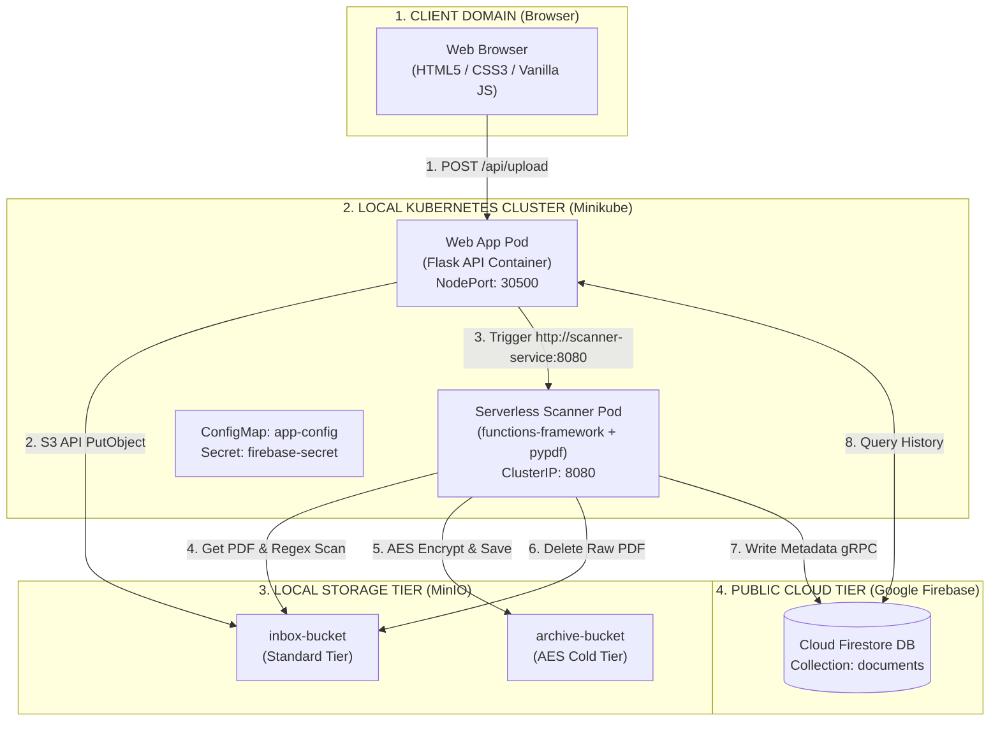

Enterprise organizations (banks, law firms, healthcare providers) receive thousands of unstructured documents daily (scanned IDs, invoices, loan applications, contracts).

Under international privacy regulations (GDPR, HIPAA), storing unencrypted **Personally Identifiable Information (PII)**—such as Credit Card numbers or Social Security Numbers (SSNs)—in unmonitored storage violates compliance laws and results in severe regulatory fines.

### The Solution Architecture

This project implements an automated, secure **Hybrid Cloud Compliance & Analytics Pipeline**:

1. **Edge Ingestion:** Branch office employees upload documents via a lightweight local Web Portal.
2. **Local Storage & Ingestion:** Files land in a standard ingestion object storage bucket managed locally via **MinIO**.
3. **Serverless Compliance Inspection:** An event-driven serverless function (`functions-framework`) automatically wakes up, extracts text using Python (`pypdf`), and executes Regex PII scanning rules.
4. **Automated Data Tiering & Encryption:**
  - **Restricted Data:** Files containing PII are encrypted (AES-256) and moved to a long-term **Cold Storage Archive Bucket**.
  - **Public Data:** Clean files are classified as `PUBLIC` and routed to standard storage.
5. **Real-time NoSQL Indexing:** File metadata, risk classifications, and detected PII tags are indexed instantly in **Google Cloud Firestore** (Firebase Spark Plan) for live dashboard display.
6. **Enterprise Analytics & Reporting:** Compliance logs are streamed into **BigQuery Sandbox** for analytical SQL reporting on compliance trends.

---

## 2. Complete Architecture Diagram

---

## 3. Technology Stack & Component Breakdown

<table>
  <tr><th>Layer</th><th>Selected Technology</th><th>Role in System</th></tr>
  <tr><td>Frontend UI</td><td>HTML5, CSS3, Vanilla JavaScript</td><td>Pure client-side UI using native fetch() API for uploads and live status polling.</td></tr>
  <tr><td>Backend API</td><td>Python Flask</td><td>Lightweight API server handling upload relays, containerized in Docker.</td></tr>
  <tr><td>Local Object Storage</td><td>MinIO Container</td><td>S3/GCS-compatible object storage managing inbox-bucket and archive-bucket.</td></tr>
  <tr><td>Serverless Compute</td><td>Python functions-framework</td><td>Event-driven microservice executing PDF parsing (pypdf), PII Regex, and AES encryption.</td></tr>
  <tr><td>NoSQL Metadata DB</td><td>Google Cloud Firestore</td><td>Live cloud document database tracking document status on the Firebase Spark Plan ($0).</td></tr>
  <tr><td>Container Orchestration</td><td>Docker &amp; Kubernetes (K3s/Minikube)</td><td>Local microservice container management, deployments, and services configuration.</td></tr>
  <tr><td>Infrastructure as Code</td><td>HashiCorp Terraform</td><td>Declarative HCL scripts automating local storage bucket creation and IAM policies.</td></tr>
  <tr><td>CI/CD &amp; DevOps</td><td>GitHub &amp; GitHub Actions</td><td>Version control and automated Python testing pipelines for PII detection logic.</td></tr>
</table>

---
