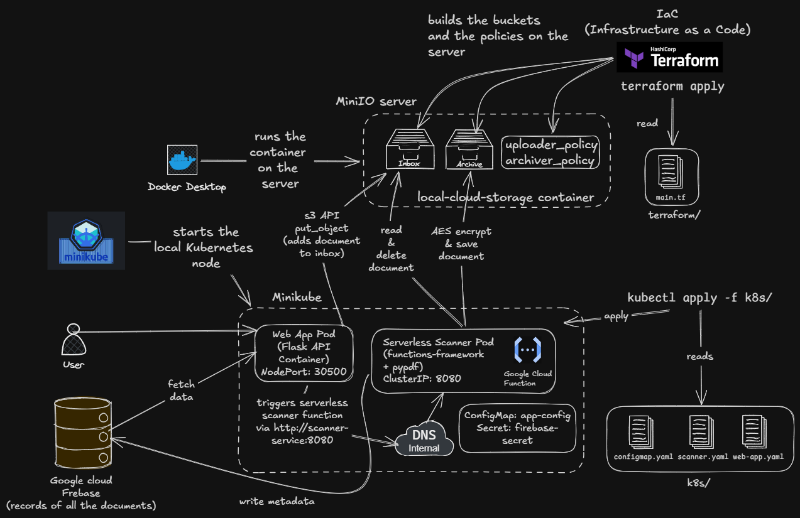

### How to Safely Stop Everything

When you finish working for the day, follow these 3 simple commands in order:

**Step 1: Delete Kubernetes Resources**

In your terminal inside the project root folder:

```powershell
kubectl delete -f k8s/
```

- **What it does:** Cleanly terminates the Scanner worker, Web App, Redis queue pods, deployments, and services from your Kubernetes cluster.

**Step 2: Pause Minikube**

```powershell
minikube stop
```

- **What it does:** Safely pauses the Minikube cluster container, saving your CPU and RAM.

**Step 3: Destroy Storage Buckets & Stop Docker Containers**

```powershell
cd terraform
terraform destroy -auto-approve
cd ..
docker compose down
```

---

### How to Bring Everything Back Up Next Time

You can run the project in **two ways**:

#### Method A: Full Kubernetes Workflow (Minikube — Syllabus Hybrid Cloud Standard)

1. **Start Local Storage & Provision All 3 Buckets (`inbox`, `archive`, `public`):**
  ```powershell
  docker compose up -d minio
  cd terraform
  terraform apply -auto-approve
  cd ..
  ```

2. **Start Minikube & Build Local Images (if code was updated):**
  ```powershell
  minikube start

  # Point your PowerShell to Minikube's Docker daemon to build images:
  & minikube -p minikube docker-env --shell powershell | Invoke-Expression
  docker build -t doc-app:v1 ./src/app
  docker build -t doc-scanner:v1 ./src/function
  ```

3. **Deploy Kubernetes Manifests (App, Scanner Worker & Redis Queue):**
  ```powershell
  kubectl apply -f k8s/
  ```

4. **Open the Web App in Browser:**
  ```powershell
  minikube service web-app-service
  ```

---

#### Method B: Fast Local Docker Compose (Without Minikube)

If you just want to run and test everything locally without spinning up a Kubernetes cluster:

1. **Start Storage, Redis, Scanner & Web App:**
  ```powershell
  docker compose up -d minio redis
  cd terraform
  terraform apply -auto-approve
  cd ..
  docker compose up -d --build
  ```

2. **Access Web App & MinIO Console:**
  - Web Portal: `http://localhost:5000`
  - MinIO Console: `http://localhost:9001` (User: `minioadmin` / Pass: `minioadminpassword`)

3. **Stop Docker Compose:**
  ```powershell
  cd terraform
  terraform destroy -auto-approve
  cd ..
  docker compose down
  ```

---

### MinIO Storage Tiers

MinIO acts as our S3-compatible multi-tier object storage:
1. **`inbox-bucket`**: Ingestion landing zone for raw uploaded PDFs (purged after processing).
2. **`archive-bucket`**: Private cold vault storing AES-256 encrypted original PDFs.
3. **`public-bucket`**: Public viewing tier storing PyMuPDF-redacted PDFs for staff download.

---

### What is functions-framework?

In production Google Cloud, when a file hits a bucket, GCP automatically executes your Python code inside a managed container.

How does Google do this? Google built an open-source tool called **functions-framework**.

- It takes a normal Python function (e.g., `def scan_document(request):`) and turns it into a web server listener.
- In our v2.0 architecture, the scanner also runs a background daemon worker thread continuously consuming asynchronous jobs from **Redis** via `blpop`.

---

### Our Flask backend has 4 core routes:

- **`GET /` (Serves the UI):**
  - Renders `index.html` from `template/`.
- **`POST /api/upload` (Handles File Upload & Redis Queue Dispatch):**
  - Receives the uploaded PDF file from JavaScript (`FormData`).
  - Saves the raw file directly into MinIO `inbox-bucket`.
  - Pushes `{ "filename": filename }` asynchronously into the **Redis Message Queue** (`scan_queue`).
  - Immediately returns a non-blocking `200 OK` response with `status: "QUEUED"` to keep the UI fast and responsive.
- **`GET /api/download/<filename>` (Downloads Redacted Documents):**
  - Retrieves the PyMuPDF-redacted document from MinIO `public-bucket` and serves it as a downloadable PDF.
- **`GET /api/documents` (Fetches Live Compliance History):**
  - Queries Cloud Firestore `documents` collection.
  - Retrieves all processed documents ordered by timestamp.
  - Returns a JSON array so JavaScript can render the live status table with classification badges and redaction download links.

---


