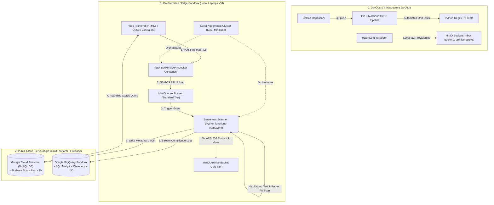

# Master Project Architecture & Navigation Plan

**Project Title:** *An Automated Hybrid Cloud Platform for Document Compliance, Storage Tiering, and PII Intelligence*  
**Document Purpose:** Single Source of Truth (SSOT) & Navigation Document for Project Execution

---

## 1. Executive Summary & Real-World Business Context

### The Business Problem

Enterprise organizations (banks, law firms, healthcare providers) receive thousands of unstructured documents daily (scanned IDs, invoices, loan applications, contracts).

Under international privacy regulations (GDPR, HIPAA), storing unencrypted **Personally Identifiable Information (PII)**—such as Credit Card numbers or Social Security Numbers (SSNs)—in unmonitored storage violates compliance laws and results in severe regulatory fines.

### The Solution Architecture

This project implements an automated, secure **Hybrid Cloud Compliance & Analytics Pipeline**:

1. **Edge Ingestion:** Branch office employees upload documents via a lightweight local Web Portal.
2. **Local Storage & Ingestion:** Files land in a standard ingestion object storage bucket managed locally via **MinIO**.
3. **Serverless Compliance Inspection:** An event-driven serverless function (`functions-framework`) automatically wakes up, extracts text using Python (`pypdf`), and executes Regex PII scanning rules.
4. **Automated Data Tiering & Encryption:**
  - **Restricted Data:** Files containing PII are encrypted (AES-256) and moved to a long-term **Cold Storage Archive Bucket**.
  - **Public Data:** Clean files are classified as `PUBLIC` and routed to standard storage.
5. **Real-time NoSQL Indexing:** File metadata, risk classifications, and detected PII tags are indexed instantly in **Google Cloud Firestore** (Firebase Spark Plan) for live dashboard display.
6. **Enterprise Analytics & Reporting:** Compliance logs are streamed into **BigQuery Sandbox** for analytical SQL reporting on compliance trends.

---

## 2. Complete Architecture Diagram

---

## 3. Technology Stack & Component Breakdown

<table>
  <tr><th>Layer</th><th>Selected Technology</th><th>Role in System</th></tr>
  <tr><td>Frontend UI</td><td>HTML5, CSS3, Vanilla JavaScript</td><td>Pure client-side UI using native fetch() API for uploads and live status polling.</td></tr>
  <tr><td>Backend API</td><td>Python Flask</td><td>Lightweight API server handling upload relays, containerized in Docker.</td></tr>
  <tr><td>Local Object Storage</td><td>MinIO Container</td><td>S3/GCS-compatible object storage managing inbox-bucket and archive-bucket.</td></tr>
  <tr><td>Serverless Compute</td><td>Python functions-framework</td><td>Event-driven microservice executing PDF parsing (pypdf), PII Regex, and AES encryption.</td></tr>
  <tr><td>NoSQL Metadata DB</td><td>Google Cloud Firestore</td><td>Live cloud document database tracking document status on the Firebase Spark Plan ($0).</td></tr>
  <tr><td>Data Warehouse</td><td>Google BigQuery Sandbox</td><td>Serverless SQL data warehouse for executing aggregate compliance analytical queries ($0).</td></tr>
  <tr><td>Container Orchestration</td><td>Docker &amp; Kubernetes (K3s/Minikube)</td><td>Local microservice container management, deployments, and services configuration.</td></tr>
  <tr><td>Infrastructure as Code</td><td>HashiCorp Terraform</td><td>Declarative HCL scripts automating local storage bucket creation and IAM policies.</td></tr>
  <tr><td>CI/CD &amp; DevOps</td><td>GitHub &amp; GitHub Actions</td><td>Version control and automated Python testing pipelines for PII detection logic.</td></tr>
</table>

---

## 4. Syllabus Mapping & Academic Alignment

<table>
  <tr><th>Syllabus Unit</th><th>Practical Implementation in This Architecture</th></tr>
  <tr><td>Unit-I: Cloud Architecture</td><td>Hybrid Cloud Model: On-premises edge infrastructure (Docker/MinIO) seamlessly integrated with public cloud database endpoints (Firestore / BigQuery).</td></tr>
  <tr><td>Unit-II: Virtualization</td><td>OS &amp; Hypervisor Virtualization: Docker runtime execution hosting isolated containers, optionally running inside a VirtualBox Linux VM.</td></tr>
  <tr><td>Unit-III: Cloud Services &amp; Containers</td><td>Microservices &amp; Serverless: Local Kubernetes cluster (K3s/Minikube) managing container deployments; Serverless event-driven execution via functions-framework.</td></tr>
  <tr><td>Unit-IV: Cloud Storage &amp; Analytics</td><td>Data Tiering &amp; OLAP Analytics: Multi-tier storage (MinIO Standard vs Archive), NoSQL document indexing (Firestore), and Big Data SQL queries (BigQuery Sandbox).</td></tr>
  <tr><td>Unit-V: DevOps &amp; Service Management</td><td>IaC &amp; CI/CD Pipelines: Infrastructure provisioning via Terraform scripts; Continuous Integration workflows via GitHub Actions.</td></tr>
  <tr><td>Unit-VI: Security &amp; Networking</td><td>Least Privilege &amp; Data Protection: MinIO S3 JSON IAM policies, Firestore security rules, client-side AES encryption, .gitignore secret isolation, and $0 budget enforcement.</td></tr>
</table>

---

## 5. Sequential Master Execution Roadmap

### Phase 1: Local Cloud Baseline & Safety Setup *(COMPLETED)*

- [x] Verified Git, Docker, Python 3, and Terraform CLI installations.
- [x] Created Firebase Project on $0 Spark Plan (No Credit Card).
- [x] Downloaded and secured `firebase-key.json` inside `.gitignore` secrets directory.

### Phase 2: Infrastructure as Code (Terraform + MinIO) *(COMPLETED & VERIFIED)*

- [x] Created `docker-compose.yml` for local MinIO Object Storage (`http://localhost:9001`).
- [x] Wrote `terraform/main.tf` using HashiCorp MinIO Provider.
- [x] Executed `terraform apply` to provision `inbox-bucket` and `archive-bucket`.

### Phase 3: Serverless Document Scanner & PII Detector *(NEXT IMMEDIATE STEP)*

- [x] Set up Python `functions-framework` serverless microservice.
- [x] Write PDF text extraction module using `pypdf`.
- [x] Implement Regex scanning algorithms for:
  - Credit Cards (16-digit pattern)
  - Social Security / National IDs
  - Sensitive keywords (`CONFIDENTIAL`, `RESTRICTED`, `PASSPORT`).
- [x] Implement AES payload encryption before archiving files to `archive-bucket`.
- [x] Connect Python scanner to Firestore to write compliance metadata JSON records.

### Phase 4: Edge Web Application (Flask + HTML/CSS/JS)

- [x] Build Flask backend API endpoints (`/upload`, `/status`).
- [x] Build pure HTML5/CSS3/Vanilla JS frontend with drag-and-drop file upload.
- [x] Connect JS `fetch()` calls to Flask API and live Firestore updates.
- [x] Package Web Application into a standalone Docker container.

### Phase 5: Local Kubernetes (K3s / Minikube) Orchestration

- [x] Write Kubernetes manifest files:
  - `deployment.yaml` for Flask Backend and Scanner microservices.
  - `service.yaml` to expose NodePort/ClusterIP endpoints.
  - `configmap.yaml` & `secret.yaml` for environment variable injection.
- [x] Deploy and verify cluster health using `kubectl`.

### Phase 6: Granular IAM Policies & BigQuery Analytics

- [ ] Write MinIO JSON IAM Access Policies (`UploaderPolicy` vs `ArchiverPolicy`).
- [ ] Write Firestore Granular Database Security Rules.
- [ ] Enable BigQuery Sandbox ($0 Plan) and create compliance dataset.
- [ ] Write SQL analytical queries for compliance reporting.

### Phase 7: DevOps CI/CD & Final Project Verification

- [ ] Create GitHub repository and commit clean project structure.
- [ ] Write `.github/workflows/ci.yml` for automated Python unit testing on PII regex rules.
- [ ] End-to-end verification and preparation of project documentation and demo presentation.

---

## 6. Daily Workstation Lifecycle Commands

- **To start local cloud storage:**  
`docker compose up -d`
- **To provision storage buckets:**  
`cd terraform && terraform apply -auto-approve`
- **To clean shutdown at the end of the day:**  
`cd terraform && terraform destroy -auto-approve && cd .. && docker compose down`

---

*This document serves as our finalized, single source of truth for the entire project lifecycle.*
