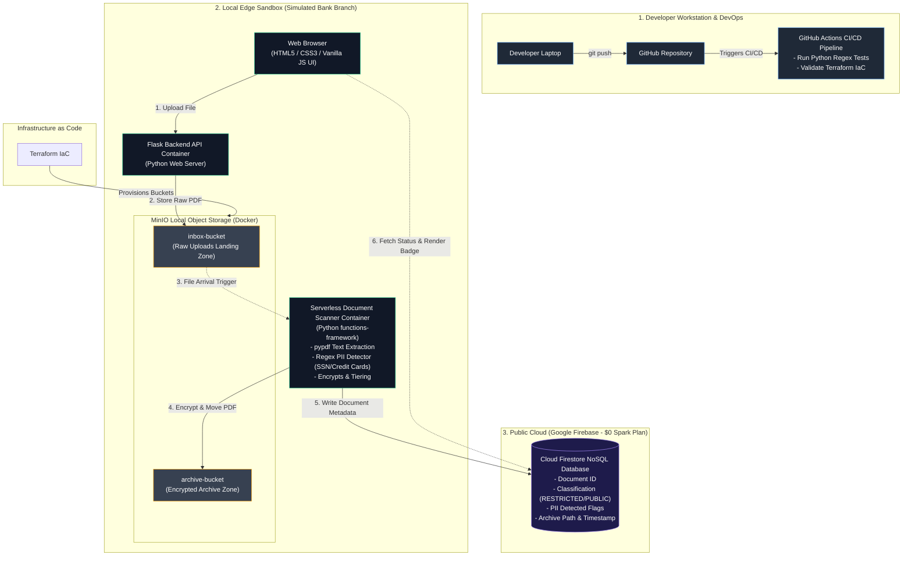

### The Real-World Business Purpose (Why This App Exists)

Imagine you work for **Global Bank Corp**.

Global Bank has hundreds of regional branch offices. Every day, bank tellers scan customer documents: loan applications, tax forms, ID copies, and handwritten notes.

#### **The Risk:**

Under privacy laws (like GDPR), storing unencrypted customer credit card numbers or Social Security Numbers (SSNs) in an open folder is illegal. If a bank teller accidentally uploads a PDF containing an unmasked credit card number, **the bank faces huge regulatory fines**.

#### **The Solution (Your Project):**

You are building an **Automated Compliance Engine**:

- A bank teller opens the local **Branch Web UI** (HTML/CSS/JS) and drops a scanned PDF.
- The file is uploaded to the **Inbox Bucket**.
- A **Serverless Function** automatically wakes up, extracts text from the PDF, and scans for sensitive PII (credit cards, SSNs, sensitive keywords).
- **Classification & Action:**
  - If sensitive PII is found ->Flags as RESTRICTED, encrypts the PDF, and moves it to the **Archive Bucket**.
  - If no PII is found -> Flags as PUBLIC and moves to standard storage.
- Metadata (file name, classification, PII detected, timestamp) is written to **Cloud Firestore**.
- The teller's browser dashboard immediately updates with a green or red compliance status badge!



### Trace a Single File (The Step-by-Step Story)

Let's trace what happens when bank teller "John" uploads loan_application.pdf:

- **Upload:** John opens [http://localhost:5000](http://localhost:5000) on his browser, selects loan_application.pdf, and clicks "Upload".
- **Relay:** The **HTML/JS UI** sends the file via a POST request to the **Flask Backend API**.
- **Inbox Landing:** Flask writes loan_application.pdf into the local inbox-bucket inside **MinIO** (which was created automatically by our **Terraform** script!).
- **Serverless Trigger:** The **Serverless Document Scanner** (Python functions-framework) detects the new file in inbox-bucket.
- **PII Analysis:** The scanner extracts text from the PDF using Python (pypdf) and runs **Regex patterns**:
  - Result: Found a 16-digit string matching a Visa card format!
- **Archiving & Encrypting:** The scanner flags the file as RESTRICTED, encrypts the PDF payload, moves it into archive-bucket, and deletes the raw file from inbox-bucket.
- **Metadata Indexing:** The scanner connects to **Firebase Cloud Firestore** over HTTPS and writes a record:
  codeJSON
  ```plaintext
  {
    "filename": "loan_application.pdf",
    "classification": "RESTRICTED",
    "pii_detected": ["CREDIT_CARD"],
    "timestamp": "2026-08-04T18:15:00Z",
    "status": "ARCHIVED"
  }

  ```
- **Real-time Display:** The **Vanilla JS frontend** fetches the status from Firestore and displays:  
**loan_application.pdf - RESTRICTED (Credit Card Detected) - Archived Safely**.

### Tech Stack

- **HTML / CSS / Vanilla JavaScript:** The visual web page running in the browser where users drop files and view compliance reports.
- **Python Flask API:** The lightweight backend web server that bridges the browser UI with our local storage.
- **Docker & Docker Compose:** Runs MinIO, Flask, and the Serverless Scanner in isolated containers on your laptop.
- **MinIO:** Our local Object Storage server (acts like GCP Cloud Storage) to hold raw and archived PDFs.
- **Terraform:** The Infrastructure-as-Code tool that automatically sets up inbox-bucket and archive-bucket inside MinIO with one command.
- **Firebase Cloud Firestore:** The live NoSQL cloud database storing lightweight JSON search records (free $0 Spark plan).
- **GitHub & GitHub Actions (CI/CD):** Where your code lives. When you push updates to GitHub, GitHub Actions runs automated Python tests to verify your PII scanner regex works without errors
