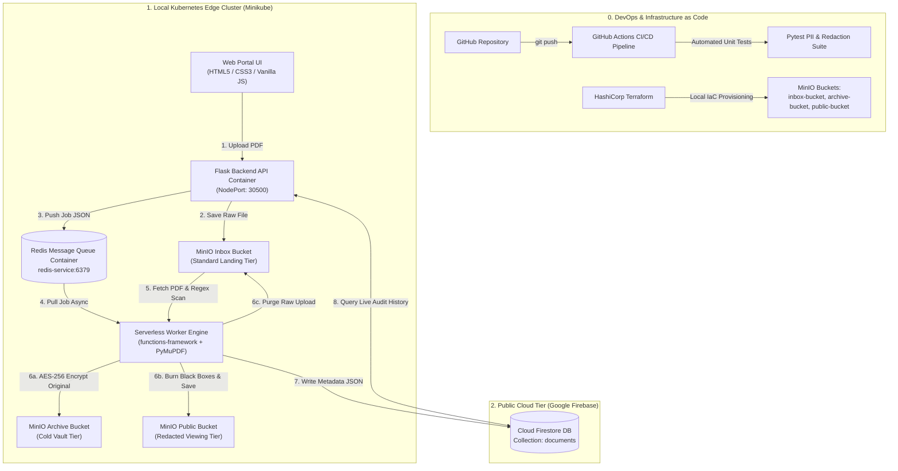

# 📄 Master Project Architecture & Navigation Plan (Version 2.0)

**Project Title:** *An Automated Hybrid Cloud Platform for Document Compliance, Asynchronous Processing, Storage Tiering, and PII Redaction*  
**Document Purpose:** Single Source of Truth (SSOT) & Navigation Document for Project Execution  
**Financial Guarantee:** $0.00 Total Cost (No Credit Card / Payment Info Required)

---

## 1. Executive Summary & Real-World Business Context

### The Business Problem
Enterprise organizations (banks, healthcare providers, law firms) process thousands of unstructured documents daily (scanned IDs, invoices, tax forms, contracts). Storing unencrypted **Personally Identifiable Information (PII)**—such as Credit Cards, Social Security Numbers, Aadhaar, or PAN details—violates data privacy laws (GDPR, HIPAA) and results in severe financial penalties. Furthermore, synchronous file processing freezes user interfaces, causing poor performance and system timeouts.

### The Solution Architecture
This project implements an automated, asynchronous **Hybrid Cloud Compliance & Data Anonymization Pipeline**:
1. **Edge Ingestion:** Users upload documents via a responsive HTML5/CSS3/Vanilla JS Web Portal served by a Flask API.
2. **Asynchronous Task Queueing (Redis):** The API saves the raw file to MinIO `inbox-bucket`, pushes a job payload to a **Redis Message Queue**, and immediately returns a non-blocking `200 OK` response to the user.
3. **Serverless Compliance & Redaction Engine:** Background Worker Pods (`functions-framework`) pull jobs from Redis, extract text (`pypdf`), and scan for global and Indian PII patterns (Aadhaar, PAN, SSN, Credit Cards, Passports, IFSC, UPI).
4. **Automated PDF Masking & Redaction (PyMuPDF):** When PII is detected, the engine finds the exact coordinate bounding boxes of the sensitive text and **burns solid black redaction boxes** onto the PDF, outputting a safe `redacted_doc.pdf` to MinIO **`public-bucket`**.
5. **Multi-Tier Storage & AES Encryption:**
   - **Private Vault Tier:** Raw PDFs are encrypted using symmetric **AES-256** and archived in MinIO **`archive-bucket`**.
   - **Public Viewing Tier:** Redacted PDFs are stored in MinIO **`public-bucket`** for safe viewing by staff.
   - **Ingestion Purge:** Raw unencrypted files are permanently deleted from `inbox-bucket`.
6. **Real-time NoSQL Indexing:** Compliance status and metadata are indexed in **Google Cloud Firestore** ($0 Spark Plan).

---

## 2. Updated Complete Architecture Diagram (Mermaid JS)

---

## 3. Technology Stack & Component Breakdown

| Layer | Selected Technology | Role in System |
| :--- | :--- | :--- |
| **Frontend UI** | HTML5, CSS3, Vanilla JavaScript | Client-side UI using native `fetch()` API for drag-and-drop uploads and status polling. |
| **Backend API** | Python Flask | Lightweight web server handling ingestion and Redis task dispatching. |
| **Message Queue** | Redis Container | Asynchronous job queue (`redis-service:6379`) decoupling ingestion from processing. |
| **Local Object Storage** | MinIO Engine | S3/GCS-compatible storage managing `inbox-bucket`, `archive-bucket`, and `public-bucket`. |
| **Compliance Worker** | Python `functions-framework` | Serverless background worker pulling tasks from Redis. |
| **Parsing & Inspection** | `pypdf` + Regex Engine | Extracts text streams and detects global/Indian PII (Aadhaar, PAN, SSN, UPI, Cards). |
| **PDF Redaction Engine** | PyMuPDF (`fitz`) | Locates PII bounding box coordinates and burns solid black masking boxes onto PDF pages. |
| **NoSQL Metadata DB** | Google Cloud Firestore | Real-time cloud document database tracking compliance audit logs ($0 Spark Plan). |
| **Orchestration** | Kubernetes (Minikube) | Microservices container management, NodePort/ClusterIP services, and Secrets mounting. |
| **Infrastructure as Code** | HashiCorp Terraform | Declarative HCL scripts provisioning storage buckets and S3 IAM access policies. |
| **CI/CD & DevOps** | GitHub & GitHub Actions | Automated Python unit testing (`pytest`), Terraform syntax validation, and Docker builds. |

---

## 4. Syllabus Mapping & Academic Alignment

| Syllabus Unit | Practical Implementation in This Architecture |
| :--- | :--- |
| **Unit-I: Cloud Architecture** | **Hybrid Cloud Model:** Local Kubernetes Edge infrastructure integrated with Google Cloud Firestore. |
| **Unit-II: Virtualization** | **OS & Container Virtualization:** Docker Engine hosting containerized services (Flask, MinIO, Redis, Worker). |
| **Unit-III: Cloud Services & Containers** | **Microservices, Queuing & Serverless:** Local Kubernetes cluster (Minikube) orchestrating pods; **Redis Message Queue** for asynchronous processing; Serverless execution via `functions-framework`. |
| **Unit-IV: Cloud Storage & Analytics** | **Multi-Tier Storage & Anonymization:** MinIO Standard Ingestion (`inbox`), AES Cold Vault (`archive`), and Redacted Public Tier (`public`); Firestore NoSQL document indexing. |
| **Unit-V: DevOps & Service Management** | **IaC & CI/CD Pipelines:** HashiCorp Terraform bucket/IAM provisioning; Continuous Integration via GitHub Actions. |
| **Unit-VI: Security & Data Privacy** | **Data Anonymization & Least Privilege:** Automatic PDF text blacking (Redaction), AES-256 encryption, MinIO S3 IAM JSON policies, Kubernetes Secrets (`firebase-secret`), $0 budget guarantee. |

---

## 5. Master Execution Roadmap & Status

### Phase 1: Local Baseline & Safety Setup *(COMPLETED)*
- [x] Verified Git, Docker, Python 3, and Terraform CLI installations.
- [x] Configured Google Firebase Firestore ($0 Spark Plan) and secured `firebase-key.json` in `.gitignore`.

### Phase 2: Infrastructure as Code (Terraform + MinIO) *(COMPLETED)*
- [x] Configured MinIO Object Storage (`http://localhost:9001`).
- [x] Wrote `terraform/main.tf` provisioning `inbox-bucket` and `archive-bucket`.

### Phase 3: Serverless Scanner & PII Detector Engine *(COMPLETED)*
- [x] Built serverless scanner (`functions-framework` + `pypdf`).
- [x] Implemented PII Regex detection (Aadhaar, PAN, SSN, Cards, Passports, UPI, DL, IFSC).
- [x] Integrated AES-256 encryption and Firestore metadata indexing.

### Phase 4: Edge Web Application (Flask + HTML/CSS/JS) *(COMPLETED)*
- [x] Built Flask backend API (`app.py`).
- [x] Created responsive HTML5/CSS3/Vanilla JS Web Portal.

### Phase 5: Local Kubernetes Orchestration *(COMPLETED)*
- [x] Containerized Docker images (`doc-app:v1`, `doc-scanner:v1`).
- [x] Deployed and verified Kubernetes manifests (`k8s/`) on Minikube with Kubernetes Secrets.

### Phase 6: Granular IAM Least Privilege Policies *(COMPLETED)*
- [x] Provisioned S3 JSON IAM Policies (`UploaderPolicy` vs `ArchiverPolicy`) via Terraform.

### Phase 7: DevOps CI/CD Pipeline *(COMPLETED)*
- [x] Created unit test suite (`tests/test_pii.py`) with `pytest`.
- [x] Configured GitHub Actions workflow (`.github/workflows/ci.yml`).

---

### Phase 8: Advanced Scope Upgrades (Redis Queue & PDF Redaction) *(NEXT IMMEDIATE STEP)*

- [ ] **Step 8.1: Redis Task Queue Integration**
  - Add Redis container service (`redis-service:6379`) to Docker Compose & Kubernetes.
  - Update Flask API (`app.py`) to push upload jobs asynchronously into Redis queue (`scan_queue`).
  - Update Scanner (`main.py`) to act as an asynchronous worker polling Redis (`blpop`).

- [ ] **Step 8.2: PyMuPDF Automated PDF Redaction & Public Tier Output**
  - Add `public-bucket` to Terraform IaC script (`terraform/main.tf`).
  - Add `pymupdf` to `src/function/requirements.txt`.
  - Implement PyMuPDF (`fitz`) redaction logic: find PII text coordinate rects and burn solid black boxes onto PDF.
  - Save `redacted_<filename>.pdf` to MinIO `public-bucket`.
  - Update Web UI (`index.html` & `app.js`) to provide a "Download Redacted PDF" button for scanned documents.

---

## 6. Daily Workstation Lifecycle Commands

- **Start Local Storage & Redis:** `docker compose up -d`
- **Provision Storage Buckets:** `cd terraform && terraform apply -auto-approve`
- **Start Kubernetes Cluster:** `minikube start && kubectl apply -f k8s/`
- **Open Web App Portal:** `minikube service web-app-service`
- **Clean Shutdown:** `kubectl delete -f k8s/ && minikube stop && cd terraform && terraform destroy -auto-approve && cd .. && docker compose down`

---

*This document serves as our updated single source of truth for the complete project roadmap.*
